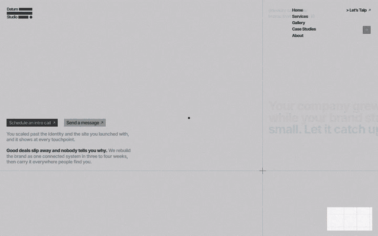

# Datum Studio — static site (clone of baseline.agency's look & behaviour)

Native HTML/CSS/JS. No build server, no framework, no hosting needed: **double-click `index.html`**.
Brand "Datum Studio", founder "Elias Marin", clients (Northwind, Vantage, Overrun, Fieldnote, Kestrel, Ninefold, Halo, Mirage),
testimonials, numbers and all copy are fictional placeholders written for this project.

## Pages
| File | What it is |
|---|---|
| `index.html` | Home: intro grid sweep, pinned split scene, white card (about, services, FAQ, ASCII "standout"), CTA, footer |
| `gallery.html` | Sticky light header + sticky left column, long media column (videos open the video modal, stills turn halftone on hover) |
| `about.html` | 9-slide deck (index links jump to slides, accordion, portrait slideshow) |
| `case-northwind.html`, `case-vantage.html`, `case-overrun.html` | Case study template (drifting photo strips, chapters, result, next case) |
| `intro.html` | Intro-call page with inline booking calendar |
| `privacy.html`, `terms.html` | Fixed grid, TOC that tracks the scrolling content pane |

## States & overlays (every page)
- **Book a call** drawer (header "Let’s Talk", hero/CTA buttons) — month nav, pick a day → time slots → name/email form with validation → "You’re booked." (nothing is sent anywhere)
- **Send a message** drawer — validation states + success state (nothing is sent)
- **Video modal** — showreel, step videos, gallery videos; play/pause, sound toggle, Esc/backdrop to close
- **Mobile menu** (9-dot button), **FAQ tabs + accordions**, **testimonial / stat / people carousels**
- **Sound**: ON by default. Hover any link/button → random soft "tap"; click/Enter → "select". Toggle with the waveform button under "Let’s Talk" (saved in localStorage). Browsers only allow audio after the first click on the page.

## Editing
The 9 HTML files are plain, hand-editable pages — edit them directly, there is no build step in this folder.
(The pages were originally generated by a Python build script, `tools/`, which is not included here, so
copy changes must be made in each HTML file; shared pieces such as the header, drawers and footer are repeated per page.)

Styles: `assets/css/base.css` (tokens, header, cursor, buttons, drawers, modal, footer), `home.css`, `pages.css`.
Scripts: `assets/js/core.js` (sound, cursor, scramble/typing, drawers, calendar, forms, modal, menu, carousels),
`home.js` (scroll choreography, showreel canvas, ASCII canvas), `pages.js` (inner pages).

## Assets & licences
- Photos: Unsplash (Unsplash License) — source URLs in `assets/img/SOURCES.json`.
- Videos: Mixkit (Mixkit Free License) — `assets/video/`.
- Sound effects: Mixkit (Mixkit Free License) — `assets/sfx/`.
- Fonts: Google Fonts (Inter, Inter Tight, Averia Serif Libre, Hedvig Letters Serif, DM Mono, Geist) loaded from fonts.googleapis.com — needs internet; falls back to Helvetica/Arial offline.

## Placeholders to replace
Brand name & logo, founder name/photo, email `hello@datum.studio`, social URLs (point at the networks' home pages),
address (Porto), client names/marks, testimonials, KPI numbers, case-study text, booking month text ("Jan’27").

## Structure
```
index.html, gallery.html, about.html, intro.html, privacy.html, terms.html, case-*.html
assets/
  css/   base.css, home.css, pages.css
  js/    core.js, home.js, pages.js, ascii-frames.js (frames for the ASCII canvas)
  img/   photos, favicon.svg, SOURCES.json
  video/ showreel, step, gallery and CTA background clips (.mp4)
  sfx/   tap_01–05.mp3, select.mp3
```
